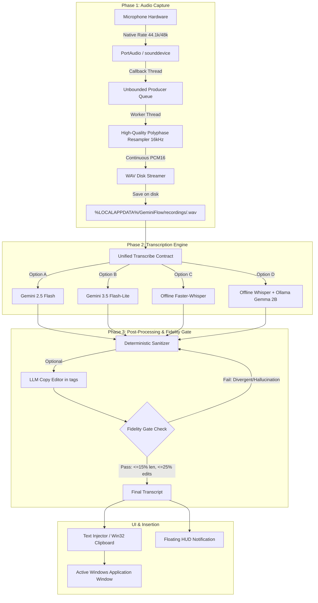

# Gemini Flow — System Architecture Specification

## 1. Overview
Gemini Flow is an enterprise-grade, low-latency Windows voice dictation and context-aware intelligence assistant. It provides sub-second speech-to-text dictation across all Windows applications with 100% offline privacy fallback, robust noise resilience, and structured command transformations.



---

## 2. Audio Capture & Buffering Architecture
1. **Hardware Ingestion**: Queries device capabilities through `sounddevice.query_devices()`. Audio is captured at the device's native sampling frequency (44.1 kHz, 48 kHz, 96 kHz) to prevent audio degradation caused by PortAudio software interpolation.
2. **Producer-Consumer Buffer**:
   * *Audio Callback*: Lightweight callback pushes raw chunks into a `queue.Queue()`. Zero file operations, zero blocking mutex acquisitions, and zero memory allocations happen inside the audio callback.
   * *Disk Writer Thread*: Pops chunks from the queue, performs polyphase resampling (`scipy.signal.resample_poly`), and streams continuous 16-bit PCM 16 kHz mono frames directly into a standard WAV file.
3. **Safety Caps & Control**:
   * Toggle recording using `Ctrl+Space`.
   * Hard safety limit set to **30 minutes** with an active UI warning if reached. No silence-based auto-stops that could truncate natural pauses in speech.
   * Crash recovery scans `%LOCALAPPDATA%/GeminiFlow/recordings/` on startup for un-transcribed or orphaned WAV files.

---

## 3. Global Hotkey Architecture
* **Implementation**: Low-level Windows keyboard hook using `pynput.keyboard.Listener` with dedicated hardware state tracking.
* **Debounce Logic**: Tracks key-down and key-up state transitions. Consecutive autorepeat events generated by Windows keyboard repeat settings are ignored, ensuring that one physical press translates to exactly one toggle.
* **App States**:
  * `Ready`: Idle, waiting for hotkey toggle.
  * `Recording`: Microphone streaming active, HUD animated waveform.
  * `Processing`: Audio finalizing, ASR engine running.
  * `Done`: Text delivered to foreground window via Win32 API.
  * `Error`: Visual feedback on failure with diagnostic toast.

---

## 4. Transcription Engine: The 4-Model Suite

### Model 1: Gemini 2.5 Flash (`gemini-2.5-flash`)
* **Role**: Primary cloud multimodal model.
* **Transport**: Direct REST API call via pooled HTTP Keep-Alive session. Chunks under 15 MB sent inline (base64 audio/wav); audio over 15 MB uploaded via Google Files API.
* **Prompt Contract**: Verbatim copy-editor prompt with `temperature: 0.0`. Validates `finish_reason` and concatenates all parts of all candidates.

### Model 2: Gemini 3.5 Flash-Lite (`gemini-3.5-flash-lite`)
* **Role**: Ultra-low-latency cloud model for rapid, short dictations.
* **Transport**: Same resilient REST harness with aggressive connection keep-alive.

### Model 3: Offline Whisper AI (`offline-whisper`)
* **Role**: 100% on-device speech-to-text with zero internet requirements.
* **Implementation**: `faster-whisper` backed by CTranslate2.
* **Model Hierarchy**: Bundled models: `small.en`, `medium.en`, `large-v3` (or `large-v3-turbo`).
* **Parameters**: Fully consumes generator (`list(segments_iter)`), `beam_size=5`, `vad_filter=True` (safe thresholds: `min_silence_duration_ms=2000`, `threshold=0.35`). Audio >25s is segmented at silence boundaries with 1.5s overlap and merged with suffix-prefix matching.

### Model 4: Ollama Gemma (`ollama-gemma2`)
* **Role**: Two-stage hybrid pipeline.
* **Stage 1 (ASR)**: Audio is transcribed on-device using `faster-whisper`.
* **Stage 2 (Text Polish)**: The resulting raw text is forwarded to Gemma 2B via the local Ollama HTTP API (`http://localhost:11434/api/generate`) for copy editing.
* **Crucial Rule**: Gemma 2B is a text model. Raw audio is **never** sent to Ollama.

---

## 5. Post-Processing & Fidelity Gate
```
Raw ASR Text ──> [Deterministic Cleanup] ──> [LLM Copy Editor] ──> [Fidelity Gate] ──> Final Output
                                     │                                  │
                                     └────────── Fail Fallback ─────────┘
```
1. **Deterministic Cleanup**:
   * Trims whitespace and normalizes Unicode apostrophes.
   * Auto-capitalizes sentence beginnings and standalone "I".
   * Expands spoken punctuation tokens ("comma", "period", "new line") when configured.
   * Strips disfluency filler words ("um", "uh") and repeated stutter tokens.
2. **LLM Polish Stage**:
   * Text enclosed inside `<dictation>...</dictation>` tags.
   * System instruction strictly prohibits answering, executing, or summarizing the text.
3. **Fidelity Gate**:
   * Compares input vs output:
     * Word length variance must be $\le 15\%$.
     * Content word replacement must be $\le 25\%$.
     * Numeric values, dates, and named entities must match.
   * On gate failure, the LLM output is rejected and the deterministic cleanup output is used.

---

## 6. Profiles & Command Registry
All 16 command categories are declared in a centralized registry (`commands.py`):
1. **Professionalize**: Formal phrasing, retains all facts and entities.
2. **Fix Grammar**: Syntax and tense repair only.
3. **Generate Code**: Python 3 standard with type hints and docstrings inside a single fenced code block. Validated via `ast.parse`.
4. **Summarize / TLDR**: Structured summary, strictly shorter than input.
5. **Create AI Prompt**: Restructures input into Role, Context, Task, Constraints, and Output Format.
6. **Executive Briefing**: High-level bullet points for leadership.
7. **Email Drafting**: Professional correspondence formatting.
8. **Meeting Action Items**: Extracts owners, tasks, and deadlines.
9. **Technical Documentation**: Markdown documentation styling.
10. **Bullet List Extraction**: Converts flowing prose into structured items.
11. **Casual to Formal**: Conversational to business conversion.
12. **Simplify / Plain English**: 8th-grade readability level.
13. **Action Checklist**: Checkbox list formatting.
14. **Customer Support Response**: Empathetic, solution-oriented replies.
15. **Bug Report Formatter**: Repro steps, expected vs actual behavior.
16. **Social / LinkedIn Post**: Hook, insights, CTA, relevant hashtags.

*Note: The deprecated "AI Model Routed" column has been excised from the UI and underlying schemas.*

---

## 7. Packaging & Distribution Artifacts
* **`dist/Gemini_Flow.exe`**: Built via PyInstaller (`onedir` unpacked, fast startup). Contains all native CTranslate2 DLLs, PyQt6 components, audio drivers, and assets.
* **`dist/Gemini_Flow_Setup_Full.exe`**: Inno Setup enterprise installer bundling the pre-built application, pre-cached offline Whisper models, and embedded runtime for 100% offline, zero-dependency installation on pristine Windows 10/11 machines.
